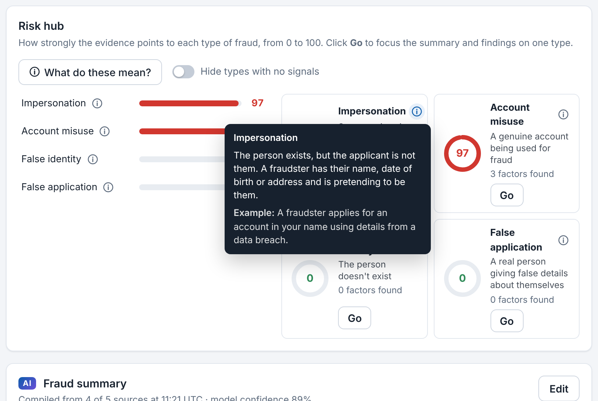
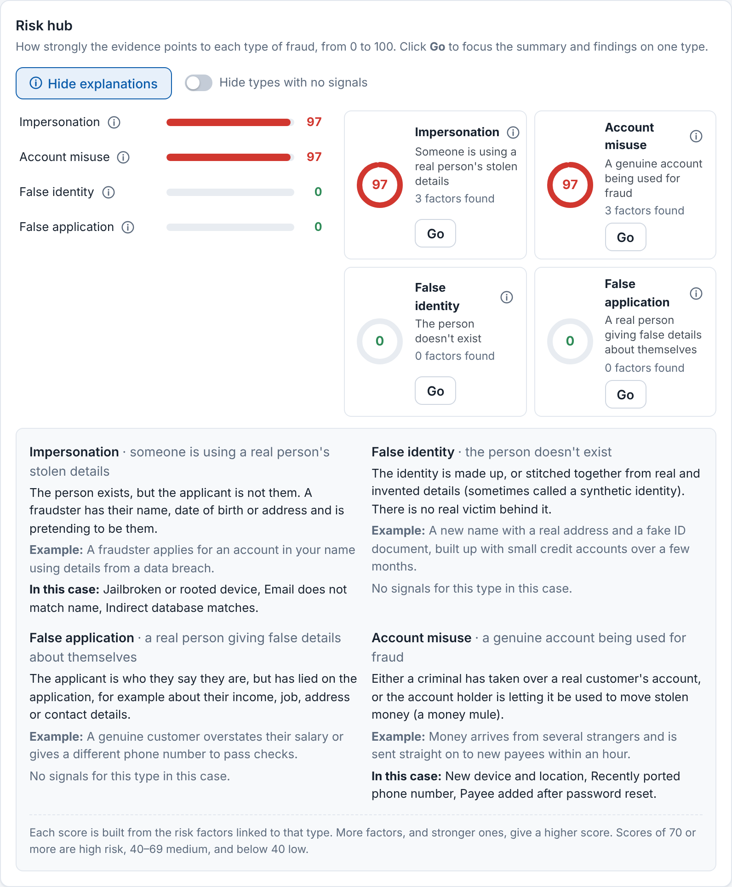
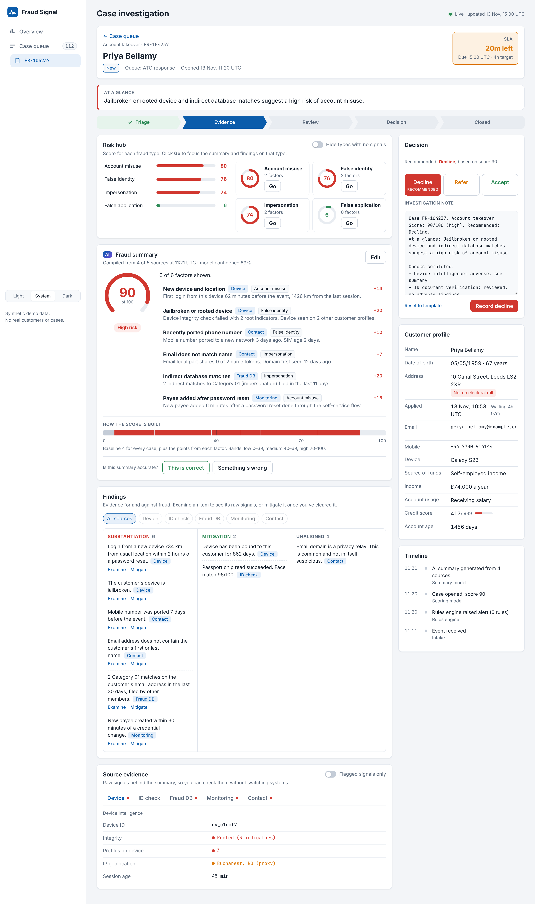
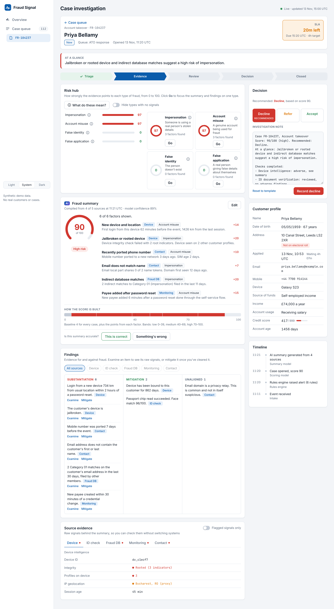
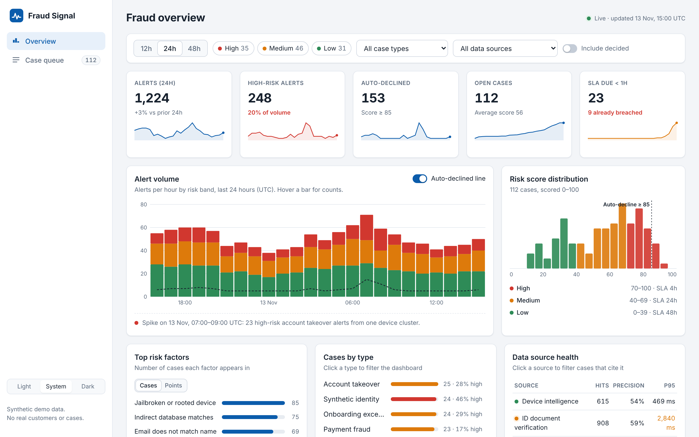

# Version comparison

Screenshots of the same case (**FR-104237**, account takeover, score 90) in each version, so you can compare them directly. All data is synthetic.

| | Version 1 | Version 2 | Version 3 |
|---|---|---|---|
| Code (branch) | [`version-1`](https://github.com/dsunwar-stack/Fraud-Data-Visualisation/tree/version-1) | [`version-2`](https://github.com/dsunwar-stack/Fraud-Data-Visualisation/tree/version-2) | [`version-3`](https://github.com/dsunwar-stack/Fraud-Data-Visualisation/tree/version-3) |
| Focus | Filters, toggles, Risk Hub and the wireframe features | Plain-English help for fraud types, based on UX principles | One Risk Hub list and clearer action buttons |

## Risk Hub

**Version 1:** fraud types appear as labels only. Anyone who doesn't know the terms has to guess what "Impersonation" or "False identity" mean.

**Version 2:** every fraud type has a one-line meaning and an ⓘ icon.

Hovering over the ⓘ (or tapping it on a phone) shows the full meaning and an example:

**What do these mean?** opens all four explanations, plus the signals in this case that count toward each type:

## Full case view

| Version 1 | Version 2 |
|---|---|
|  |  |

## Overview

This view is the same in both versions.

## What changed in version 2, and which UX principle it follows

| Change | UX principle |
|---|---|
| A one-line plain meaning on every fraud type card | Use plain language, not jargon |
| An ⓘ icon with the full meaning and an example, by hover, keyboard or tap | Help is available where it's needed and works on any device |
| **What do these mean?** panel listing the signals behind each type for this case | Explain every score |
| Risk Hub description changed to "How strongly the evidence points to each type of fraud, from 0 to 100" | Exact figures and explained scales |
| Factors moved to the correct fraud type (e.g. a ported phone number is account misuse) | Accurate information builds trust |
| A fraud type with no factors now scores 0, not 6 or 10 | Numbers must agree with each other |

## Version 3: one Risk Hub list and clear actions

Version 2 showed every fraud type twice, once as a bar and once as a ring, with a button labelled only **Go**. Version 3 puts each fraud type on a single row: name and ⓘ, plain meaning, score bar with a risk label, and a button that says what it does.

| Change | UX principle |
|---|---|
| Bars and rings merged into one row per fraud type | Show each piece of information once |
| **Go** replaced with **Show 3 factors**, and **Show all evidence** when it is active | Buttons say exactly what happens |
| Fraud types with no evidence say **No evidence found** instead of offering a button | Don't offer actions that do nothing useful |
| A risk label (High, Medium, Low, None) next to each score | Encode state in form as well as numbers |
| "None" is grey, not green | Colour has meaning: green is reserved for low risk |

Full case view, with **Show 3 factors** clicked on Impersonation:

