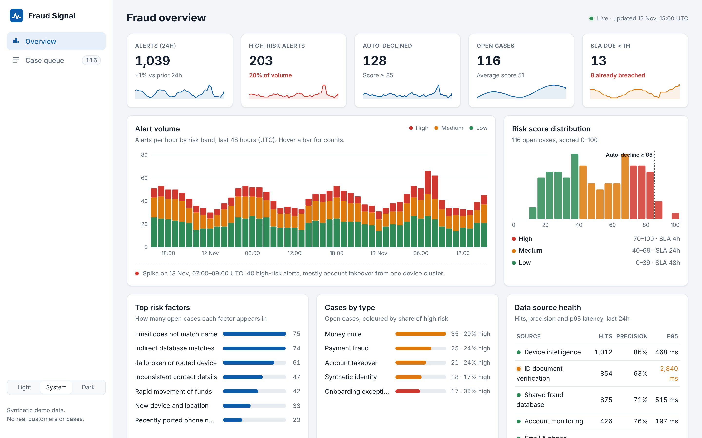
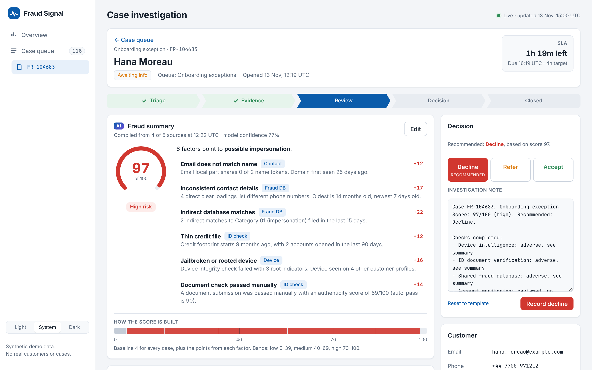
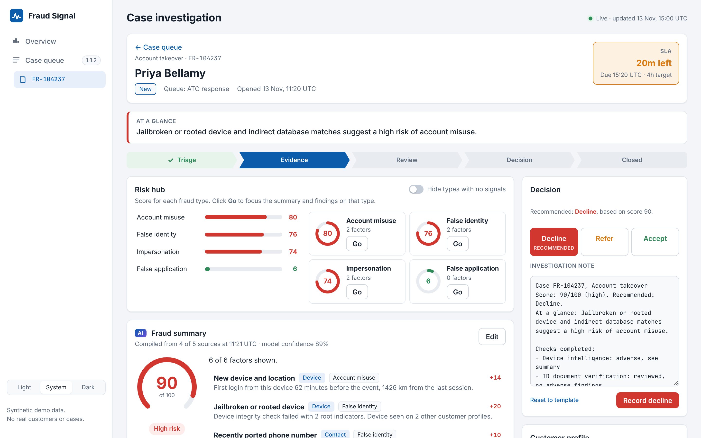
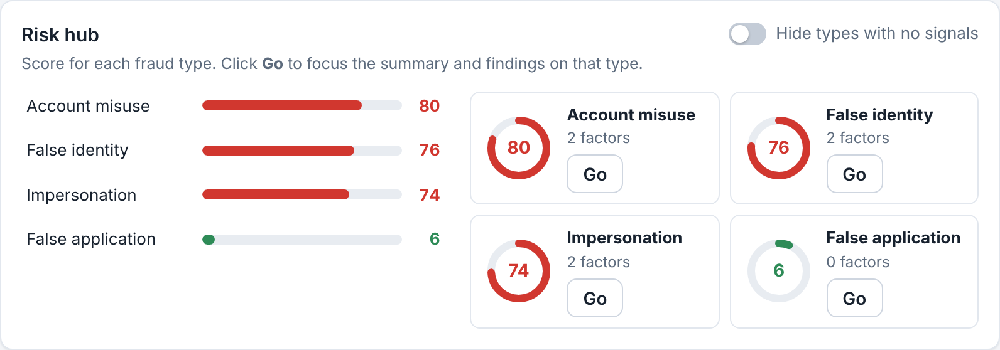
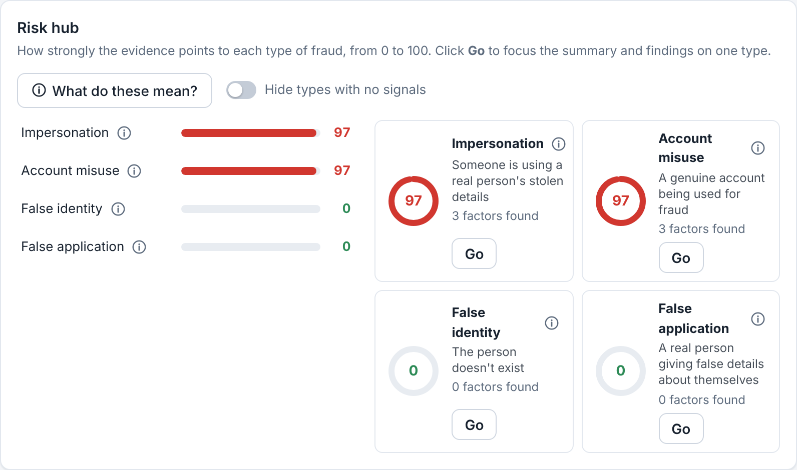
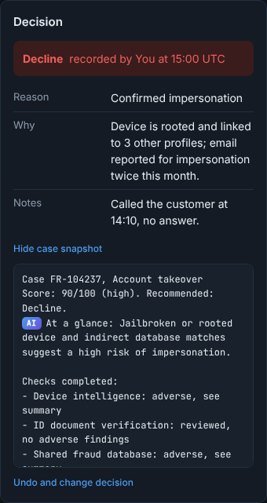

# Design history and feedback log

Every round of design feedback, what changed because of it, and why. Each round has screenshots and a saved copy of the code on its own branch, so you can open or run any earlier version.

All data is synthetic. Feedback is from the product designer reviewing the dashboard, lightly edited for spelling.

| Round | Feedback in short | What changed | Code |
|---|---|---|---|
| [1](#round-1-first-version) | Build a fraud data visualisation from the concept slides | Overview, case queue and case investigation | [`round-1`](https://github.com/dsunwar-stack/Fraud-Data-Visualisation/tree/round-1) |
| [2](#round-2-wireframe-features-filters-and-toggles) | Is the wireframe included? Add filters and toggles | Risk Hub, At a glance, full profile, Examine and Mitigate, filters and toggles | [`round-2`](https://github.com/dsunwar-stack/Fraud-Data-Visualisation/tree/round-2) |
| [3](#round-3-charts-show-their-values) | The small charts show no values when clicked | Hover or tap any card's trend line or histogram bar for values | [`round-3`](https://github.com/dsunwar-stack/Fraud-Data-Visualisation/tree/round-3) |
| [4](#round-4-explain-the-fraud-types) | People won't know what the fraud types mean | Plain meanings, info icons and an explanations panel | [`round-4`](https://github.com/dsunwar-stack/Fraud-Data-Visualisation/tree/round-4) |
| [5](#round-5-one-risk-hub-list-and-clear-buttons) | Bars and circles repeat each other; what does "Go" mean? | One row per fraud type, "Show 3 factors" button | [`round-5`](https://github.com/dsunwar-stack/Fraud-Data-Visualisation/tree/round-5) |
| [6](#round-6-explain-the-findings-columns) | What do Substantiation, Mitigation and Unaligned mean? | Plain labels and info icons on each column | [`round-6`](https://github.com/dsunwar-stack/Fraud-Data-Visualisation/tree/round-6) |
| [7](#round-7-who-decides-and-where-the-reason-goes) | Does the LLM decide? Where do I write my reason? | "You decide" statement, required reason, saved decision record | [`round-7`](https://github.com/dsunwar-stack/Fraud-Data-Visualisation/tree/round-7) |
| [8](#round-8-the-case-snapshot-is-not-a-note) | Is the investigation note written by AI? | Read-only case snapshot, one optional notes field | [`round-8`](https://github.com/dsunwar-stack/Fraud-Data-Visualisation/tree/round-8) |

To run any round locally:

```bash
git checkout round-4
```

```bash
npm install && npm run dev
```

---

## Round 1: first version

> **Feedback:** "Create a fraud data visualisation based on the slides: observability, clean UI, modern."

**What we built**
- **Overview:** summary cards, alert volume by hour, risk score distribution, top risk factors, cases by type, data source health, and cases needing attention.
- **Case queue:** a sortable table with a risk marker on each row.
- **Case investigation:** risk gauge, AI fraud summary with exact figures, score breakdown, findings, source evidence, colour-coded Decline / Refer / Accept, and a pre-filled note.

**Principles applied:** exact figures instead of vague words; explain the score; evidence in one place; colour has meaning.




---

## Round 2: wireframe features, filters and toggles

> **Feedback:** "Is this [the early wireframe slide] included?" … "Can you have filters and toggles too?"

**What changed**
- Added the missing wireframe pieces: **Risk Hub** (a score for each fraud type), **At a glance**, a **full customer profile** (date of birth, address history and electoral roll, income, credit score and more), **Examine / Mitigate** on findings, and **"This is correct"** feedback on the AI summary.
- **Shared filters** on the Overview and Case queue: risk band, case type, data source, include decided. Clicking a case type or data source on the Overview filters by it.
- **Toggles:** time range (12h / 24h / 48h), auto-declined line, rank factors by cases or points, urgent cases only, signals column, compact rows, hide empty fraud types, flagged signals only.




---

## Round 3: charts show their values

> **Feedback:** "There's no info in the graphs, such as alerts, high-risk alerts and auto-declined, when I click on the graph, whereas Alert volume has it."

**What changed**
- Every summary card's trend line now shows the value for each hour on hover or tap.
- The **Open cases** and **SLA due < 1h** lines were decorative. They are now worked out from the actual cases, so the last point matches the number on the card.
- The **risk score distribution** shows the count, share and auto-decline status for each score range.

**Principle:** charts should be readable on their own and consistent with each other.


---

## Round 4: explain the fraud types

> **Feedback:** "I think people would not know what impersonation, false identity and false application mean in the Risk Hub." … "Can we have an info icon with help text on what they mean?"

**What changed**
- A **one-line plain meaning** on each fraud type, e.g. Impersonation: "Someone is using a real person's stolen details".
- An **ⓘ icon** with the full meaning and an example. It opens on hover, keyboard focus or tap, and stays on screen on phones.
- A **"What do these mean?"** panel listing the signals behind each type for this case.
- Fixed which fraud type each factor belongs to (e.g. a ported phone number is account misuse), and a type with no factors now scores 0.

**Principles:** plain language, not jargon; help where it's needed; numbers must agree with each other.

| Before | After |
|---|---|
|  |  |


---

## Round 5: one Risk Hub list and clear buttons

> **Feedback:** "In Risk Hub we have two, one with the bar and one with the circles. Isn't it the same information? And what does Go mean to the users?"

**What changed**
- Bars and rings merged into **one row per fraud type**: name with ⓘ, plain meaning, score bar, and a risk label (High, Medium, Low, None).
- **"Go" became "Show 3 factors"** (it narrows the summary and findings to that type), and **"Show all evidence"** to undo it.
- Types with no evidence say **"No evidence found"** instead of showing a button.
- "None" is grey, because green means low risk.

**Principles:** show each piece of information once; buttons say exactly what happens.


---

## Round 6: explain the Findings columns

> **Feedback:** "In the Findings section, what do Substantiation, Mitigation and Unaligned mean?"

**What changed**
- A plain label under each column: **Supports fraud**, **Lowers the risk**, **Doesn't point either way**.
- An **ⓘ icon** on each with the full meaning and an example.
- The section description explains what **Examine** and **Mitigate** do.

The original terms were kept because fraud specialists use them; the plain labels make them clear to everyone else.


---

## Round 7: who decides, and where the reason goes

> **Feedback:** "Is the decision taken by the LLM?" … "If I decline, refer or accept, where will I leave my note on what basis I took the decision?" … "Where did this note come from, and who did this?"

**What changed**
- A clear statement in the Decision panel: **"You make the final decision. The AI summarises the evidence. The recommendation comes from the risk score, not from the AI."**
- A **required reason code** for each outcome (e.g. Decline: confirmed impersonation; Refer: a data source was unavailable or degraded; Accept: identity verified).
- A **required "Why did you make this decision?"** field in the specialist's own words.
- Choosing a different outcome from the recommendation shows a warning and is saved as an **override**.
- After recording, the panel keeps the **outcome, who, when, reason, explanation and note** visible, and the timeline records the reason.
- The pre-filled investigation note is labelled as **filled in automatically from case data, not written by anyone**.

**Principles:** the specialist decides, not the AI; every decision has a recorded reason; say where content comes from.

| Filling in a decision | After recording |
|---|---|
|  |  |

---

## Round 8: the case snapshot is not a note

> **Feedback:** "I saw that we still have an investigation note under it. Is this done by AI?"

**The answer:** no. It was filled in by a fixed template from the case data. Only the At a glance line inside it came from the AI summary. But the panel had three text boxes, and the pre-filled one looked like someone's written opinion.

**What changed**
- The pre-filled text is now a **read-only Case snapshot**, labelled "Built by a fixed template from the case data, not by AI and not by a person". The one AI-written line is marked with an **AI** badge.
- The snapshot is **attached to the decision automatically**, so reviewers see what the specialist saw. Nobody needs to edit it.
- The specialist writes in only two places: **Why did you make this decision?** (required) and a new, empty **Additional notes** box (optional).
- After recording, the decision shows Reason, Why, Notes, and a link to view the snapshot.

**Principles:** say where content comes from, and mark anything written by AI; one clear place to write; don't ask people to edit what the system already knows.

| Filling in a decision | After recording |
|---|---|
|  |  |

---

### Earlier branch names

Before this log, three versions were saved as `version-1`, `version-2` and `version-3`. They are the same code as `round-3`, `round-4` and `round-5`.
