# Design history and feedback log

> **Read it as a story:** [Fraud Signal Design Story](https://claude.ai/artifact/GdusjY27biDLL4jqm9JxaY) walks through every round with screenshots. A copy of that page is kept in [`docs/story/story.html`](../story/story.html); open it from a local clone to view it offline.

**How we keep this up to date:** every new round of feedback gets (1) a section here and in the story page, (2) screenshots in this folder named `round-N-…png`, and (3) a `round-N` branch with that round's code.

Every round of design feedback, what changed because of it, and why. Each round has screenshots and a saved copy of the code on its own branch, so you can open or run any earlier version.

All data is synthetic. Feedback is from the product designer reviewing the dashboard, lightly edited for spelling.

| Round | Feedback in short | What changed | Code |
|---|---|---|---|
| [1](#round-1-first-version) | Build a fraud data visualisation from the concept slides | Overview, case queue and case investigation | [`round-1`](https://github.com/dsunwar-stack/Fraud-Data-Visualisation/tree/round-1) |
| [2](#round-2-wireframe-features-filters-and-toggles) | Is the wireframe included? Add filters and toggles | Risk Hub, At a glance, full profile, Examine and Mitigate, filters and toggles | [`round-2`](https://github.com/dsunwar-stack/Fraud-Data-Visualisation/tree/round-2) |
| [3](#round-3-charts-show-their-values) | The small charts show no values when clicked | Hover or tap any card's trend line or histogram bar for values | [`round-3`](https://github.com/dsunwar-stack/Fraud-Data-Visualisation/tree/round-3) |
| [4](#round-4-explain-the-fraud-types) | People won't know what the fraud types mean | Plain meanings, info icons and an explanations panel | [`round-4`](https://github.com/dsunwar-stack/Fraud-Data-Visualisation/tree/round-4) |
| [5](#round-5-one-risk-hub-list-and-clear-buttons) | Bars and circles repeat each other; what does "Go" mean? | One row per fraud type, "Show 3 factors" button | [`round-5`](https://github.com/dsunwar-stack/Fraud-Data-Visualisation/tree/round-5) |
| [6](#round-6-explain-the-findings-columns) | What do Substantiation, Mitigation and Unaligned mean? | Plain labels and info icons on each column | [`round-6`](https://github.com/dsunwar-stack/Fraud-Data-Visualisation/tree/round-6) |
| [7](#round-7-who-decides-and-where-the-reason-goes) | Does the LLM decide? Where do I write my reason? | "You decide" statement, required reason, saved decision record | [`round-7`](https://github.com/dsunwar-stack/Fraud-Data-Visualisation/tree/round-7) |
| [8](#round-8-the-case-snapshot-is-not-a-note) | Is the investigation note written by AI? | Read-only case snapshot, one optional notes field | [`round-8`](https://github.com/dsunwar-stack/Fraud-Data-Visualisation/tree/round-8) |
| [9](#round-9-slds-2-design-system) | Use the SLDS 2 design system (Agentic Experiences) | SLDS 2 components and styling hooks; agentic cards and human feedback on AI content | [`round-9`](https://github.com/dsunwar-stack/Fraud-Data-Visualisation/tree/round-9) |
| [10](#round-10-slds-2-component-rules) | Follow SLDS 2 component rules for everything | Cosmos theme, page headers, vertical navigation, button groups, SLDS cards, progress bars, activity timeline, SLDS typography | [`round-10`](https://github.com/dsunwar-stack/Fraud-Data-Visualisation/tree/round-10) |
| [11](#round-11-navigation-active-state) | Why is there a half circle beside the active menu item? | Let SLDS 2 draw the vertical navigation's active state | [`round-11`](https://github.com/dsunwar-stack/Fraud-Data-Visualisation/tree/round-11) |
| [12](#round-12-top-risk-factors-explained) | What do Cases and Points mean in Top risk factors? | Both measures on every row, "Most common / Biggest impact" sort, info icon | [`round-12`](https://github.com/dsunwar-stack/Fraud-Data-Visualisation/tree/round-12) |
| [13](#round-13-design-system-and-storybook) | A design system in GitHub that designers and developers can use in live code, with separate documentation | Storybook, a separate design system site, DESIGN_SYSTEM.md, one import point | [`round-13`](https://github.com/dsunwar-stack/Fraud-Data-Visualisation/tree/round-13) |
| [14](#round-14-decision-buttons-follow-slds-2) | Are the Decline / Refer / Accept colours from SLDS 2? | SLDS radio button group for the choice; SLDS destructive / brand / success for Record | [`round-14`](https://github.com/dsunwar-stack/Fraud-Data-Visualisation/tree/round-14) |
| [15](#round-15-button-hierarchy-and-choosing-controls) | When to use radio vs dropdown? Should Record buttons differ in colour? Primary vs secondary | One primary Record button; button hierarchy and control-choice rules documented | [`round-15`](https://github.com/dsunwar-stack/Fraud-Data-Visualisation/tree/round-15) |
| [16](#round-16-scoped-notifications) | Apply SLDS 2 scoped notifications with their icons where needed | Info, warning, error, success and default notifications across Overview, queue and case | [`round-16`](https://github.com/dsunwar-stack/Fraud-Data-Visualisation/tree/round-16) |
| [17](#round-17-adjust-score-not-edit) | The Fraud summary has an Edit button but I can't edit anything | Renamed to Adjust score, explained, SLDS checkboxes, adjustment saved with the decision | [`round-17`](https://github.com/dsunwar-stack/Fraud-Data-Visualisation/tree/round-17) |
| [18](#round-18-risk-thresholds-on-screen) | What's the threshold when adjusting the score? Show it so the user knows | Risk thresholds table, auto-decline marker, threshold-crossing and large-adjustment notices | [`round-18`](https://github.com/dsunwar-stack/Fraud-Data-Visualisation/tree/round-18) |
| [19](#round-19-version-b-integrated-evidence) | Did we cater for the first Fraud Data Visualisation design? Make a Version B integrated, keep the current one | Version B: integrated Evidence card; Version A kept; A/B switch | [`round-19`](https://github.com/dsunwar-stack/Fraud-Data-Visualisation/tree/round-19) |
| [20](#round-20-one-record-the-summary-follows-the-data) | Is the Evidence data part of the graphs and the summary? Make it real and follow the data | Version B: one record per case; summary, factors and findings written from the Evidence figures; See in Evidence; platforms strip | [`round-20`](https://github.com/dsunwar-stack/Fraud-Data-Visualisation/tree/round-20) |
| [21](#round-21-observability-for-the-team-lead) | What is observability in a case manager? Where are the SLA breaches we need to act on? A new screen for the team lead to assign cases | New Observability screen: act now list with causes, assign and reassign, team workload, why cases are late, where they wait, system health, AI agreement | [`round-21`](https://github.com/dsunwar-stack/Fraud-Data-Visualisation/tree/round-21) |

To run any round locally:

```bash
git checkout round-4
```

```bash
npm install && npm run dev
```

---

## Round 1: first version

> **Feedback:** "Create a fraud data visualisation based on the slides: observability, clean UI, modern."

**What we built**
- **Overview:** summary cards, alert volume by hour, risk score distribution, top risk factors, cases by type, data source health, and cases needing attention.
- **Case queue:** a sortable table with a risk marker on each row.
- **Case investigation:** risk gauge, AI fraud summary with exact figures, score breakdown, findings, source evidence, colour-coded Decline / Refer / Accept, and a pre-filled note.

**Principles applied:** exact figures instead of vague words; explain the score; evidence in one place; colour has meaning.


---

## Round 2: wireframe features, filters and toggles

> **Feedback:** "Is this [the early wireframe slide] included?" … "Can you have filters and toggles too?"

**What changed**
- Added the missing wireframe pieces: **Risk Hub** (a score for each fraud type), **At a glance**, a **full customer profile** (date of birth, address history and electoral roll, income, credit score and more), **Examine / Mitigate** on findings, and **"This is correct"** feedback on the AI summary.
- **Shared filters** on the Overview and Case queue: risk band, case type, data source, include decided. Clicking a case type or data source on the Overview filters by it.
- **Toggles:** time range (12h / 24h / 48h), auto-declined line, rank factors by cases or points, urgent cases only, signals column, compact rows, hide empty fraud types, flagged signals only.

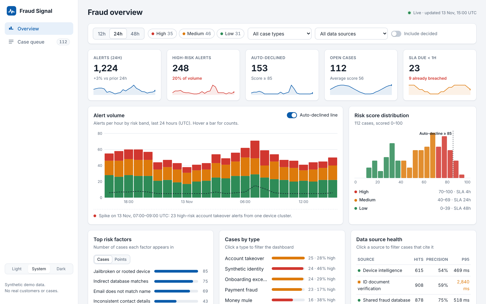


---

## Round 3: charts show their values

> **Feedback:** "There's no info in the graphs, such as alerts, high-risk alerts and auto-declined, when I click on the graph, whereas Alert volume has it."

**What changed**
- Every summary card's trend line now shows the value for each hour on hover or tap.
- The **Open cases** and **SLA due < 1h** lines were decorative. They are now worked out from the actual cases, so the last point matches the number on the card.
- The **risk score distribution** shows the count, share and auto-decline status for each score range.

**Principle:** charts should be readable on their own and consistent with each other.

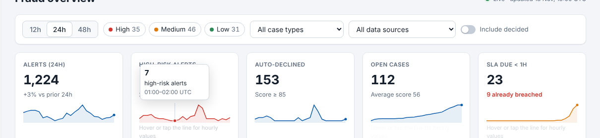
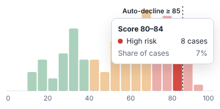

---

## Round 4: explain the fraud types

> **Feedback:** "I think people would not know what impersonation, false identity and false application mean in the Risk Hub." … "Can we have an info icon with help text on what they mean?"

**What changed**
- A **one-line plain meaning** on each fraud type, e.g. Impersonation: "Someone is using a real person's stolen details".
- An **ⓘ icon** with the full meaning and an example. It opens on hover, keyboard focus or tap, and stays on screen on phones.
- A **"What do these mean?"** panel listing the signals behind each type for this case.
- Fixed which fraud type each factor belongs to (e.g. a ported phone number is account misuse), and a type with no factors now scores 0.

**Principles:** plain language, not jargon; help where it's needed; numbers must agree with each other.

| Before | After |
|---|---|
|  |  |


---

## Round 5: one Risk Hub list and clear buttons

> **Feedback:** "In Risk Hub we have two, one with the bar and one with the circles. Isn't it the same information? And what does Go mean to the users?"

**What changed**
- Bars and rings merged into **one row per fraud type**: name with ⓘ, plain meaning, score bar, and a risk label (High, Medium, Low, None).
- **"Go" became "Show 3 factors"** (it narrows the summary and findings to that type), and **"Show all evidence"** to undo it.
- Types with no evidence say **"No evidence found"** instead of showing a button.
- "None" is grey, because green means low risk.

**Principles:** show each piece of information once; buttons say exactly what happens.

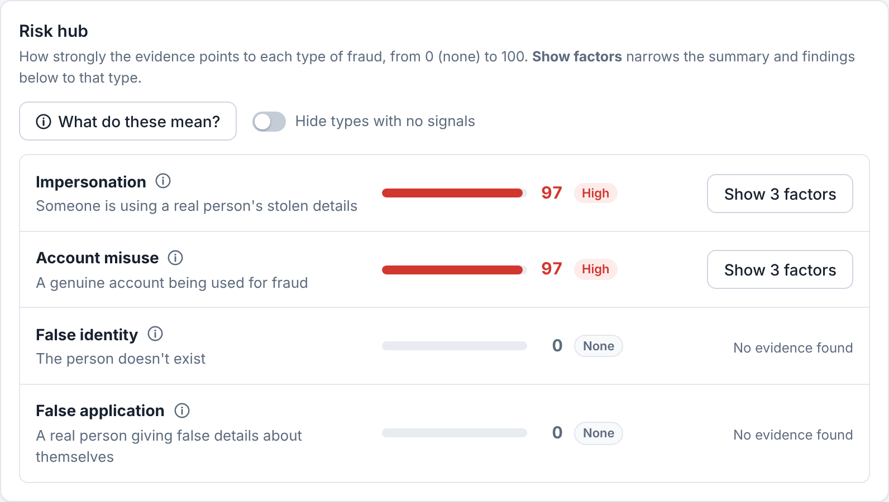
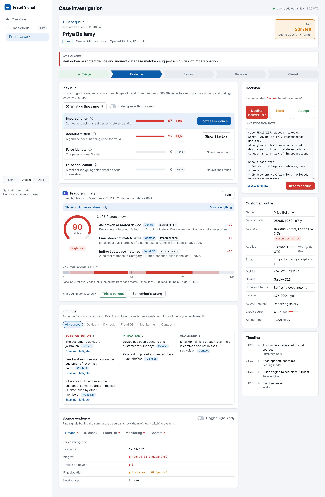

---

## Round 6: explain the Findings columns

> **Feedback:** "In the Findings section, what do Substantiation, Mitigation and Unaligned mean?"

**What changed**
- A plain label under each column: **Supports fraud**, **Lowers the risk**, **Doesn't point either way**.
- An **ⓘ icon** on each with the full meaning and an example.
- The section description explains what **Examine** and **Mitigate** do.

The original terms were kept because fraud specialists use them; the plain labels make them clear to everyone else.


---

## Round 7: who decides, and where the reason goes

> **Feedback:** "Is the decision taken by the LLM?" … "If I decline, refer or accept, where will I leave my note on what basis I took the decision?" … "Where did this note come from, and who did this?"

**What changed**
- A clear statement in the Decision panel: **"You make the final decision. The AI summarises the evidence. The recommendation comes from the risk score, not from the AI."**
- A **required reason code** for each outcome (e.g. Decline: confirmed impersonation; Refer: a data source was unavailable or degraded; Accept: identity verified).
- A **required "Why did you make this decision?"** field in the specialist's own words.
- Choosing a different outcome from the recommendation shows a warning and is saved as an **override**.
- After recording, the panel keeps the **outcome, who, when, reason, explanation and note** visible, and the timeline records the reason.
- The pre-filled investigation note is labelled as **filled in automatically from case data, not written by anyone**.

**Principles:** the specialist decides, not the AI; every decision has a recorded reason; say where content comes from.

| Filling in a decision | After recording |
|---|---|
|  |  |

---

## Round 8: the case snapshot is not a note

> **Feedback:** "I saw that we still have an investigation note under it. Is this done by AI?"

**The answer:** no. It was filled in by a fixed template from the case data. Only the At a glance line inside it came from the AI summary. But the panel had three text boxes, and the pre-filled one looked like someone's written opinion.

**What changed**
- The pre-filled text is now a **read-only Case snapshot**, labelled "Built by a fixed template from the case data, not by AI and not by a person". The one AI-written line is marked with an **AI** badge.
- The snapshot is **attached to the decision automatically**, so reviewers see what the specialist saw. Nobody needs to edit it.
- The specialist writes in only two places: **Why did you make this decision?** (required) and a new, empty **Additional notes** box (optional).
- After recording, the decision shows Reason, Why, Notes, and a link to view the snapshot.

**Principles:** say where content comes from, and mark anything written by AI; one clear place to write; don't ask people to edit what the system already knows.

| Filling in a decision | After recording |
|---|---|
|  |  |

---

## Round 9: SLDS 2 design system

> **Feedback:** "Please make sure you use the SLDS 2 design system" (SLDS 2 Pattern – Agentic Experiences library in Figma).

**What changed**
- **SLDS 2 foundation:** the official `@salesforce-ux/design-system-2` stylesheet (Lightning Blue). Every colour, font, radius and shadow now comes from SLDS 2 global styling hooks, and the system font replaces Inter.
- **SLDS 2 components:** buttons (neutral, brand, destructive, success), select menus, text areas, checkbox toggles, the path for case progress, default tabs for source evidence, tables, badges and toast messages.
- **Agentic patterns, only on AI content**, following the library's "use with restraint" principle:
  - **Agentic card** for the AI fraud summary and At a glance: sparkle icon tile, aurora gradient border, a glow that follows the cursor, and an aurora shadow on hover.
  - **At a glance** uses the Purple-95 fill and sparkle for an agentic outcome.
  - An **AI summary** label and a disclaimer: "Generated by AI from 4 data sources. Check important details in Source evidence before you decide."
  - **Human feedback** button group (👍 helpful, 👎 not helpful, copy). 👎 opens "Why wasn't it helpful?" with Inaccurate, Incomplete, Biased toxic or harmful, Inappropriate tone or style, Other, and "Tell us more". A "Thanks for your feedback" toast confirms it. This replaces "This is correct / Something's wrong".
- **Dark mode:** SLDS 2 Lightning Blue is light only, so dark mode is built from SLDS 2's own neutral and palette colours and re-points the SLDS hooks so components follow.

**Principles:** use the organisation's design system; mark AI content consistently and sparingly; a standard way to give feedback on every AI response.

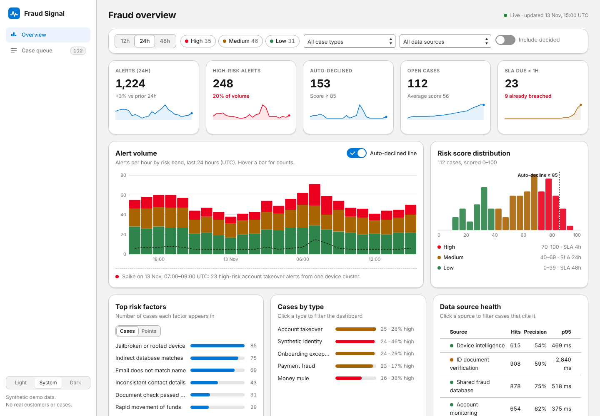

| AI summary with feedback | Dark mode |
|---|---|
|  |  |

---

## Round 10: SLDS 2 component rules

> **Feedback:** "There is the web component library for SLDS 2. Can you make sure we have used the design system rules, from typography, text, tables, buttons, filters, colours, cards, timeline to everything?" (Components for Web | Lightning Design System 2)

**Finding:** the Figma library is drawn in SLDS 2's **Cosmos** theme (the Enhanced Lightning UI), but round 9 used the older **Lightning Blue** theme. That explained most of the differences: square buttons, bold headings, a different blue, and no built-in dark mode.

**What changed, by area**

| Area | Before (round 9) | Now (SLDS 2 rule) |
|---|---|---|
| Theme | Lightning Blue | **Cosmos**: brand blue #066afe, navy heading text, 1.25rem container radius |
| Dark mode | Hand-built from palette ramps | **Built into SLDS 2 Cosmos** (light-dark hooks); no custom colours |
| Typography | Bold headings, uppercase labels, Inter-like sizes | **Regular-weight headings** in heading colour on the SLDS type scale; **sentence-case labels** in the form-label style |
| Page header | Plain page title | **SLDS page header**: object icon, object label and title; list view meta line ("112 of 148 items · Sorted by…"); **record header** with breadcrumb and a row of key fields |
| Navigation | Custom links | **SLDS vertical navigation** with sections |
| Buttons | Square | **Pill buttons** (neutral, brand, destructive, success) |
| Filters | Custom chips and segmented controls | **Checkbox button group** for risk levels (multiple choice); **radio button groups** for time range, Cases/Points, Findings source and theme (single choice) |
| Cards | Custom border, radius and shadow | **slds-card** for every card; titles regular weight |
| Tables | Custom | **SLDS data table** with link-blue case IDs, as in the list view |
| Bars and meters | Custom tracks | **SLDS progress bar** |
| Badges | Custom pills | **slds-badge** with semantic containers |
| Timeline | Custom list | **Activity timeline**: coloured icon circles, connecting line, link-blue titles, time on the right |
| Customer profile | Two-column list | **Stacked read-only fields**, as in the record page "About" card |
| Chart colours | Semantic text colours | **SLDS 2 data palette** (red-60, orange-70, teal-60, blue-60); text keeps semantic colours for contrast |

**Still custom, because SLDS 2 has no component for them:** the charts (drawn with SLDS colours), the Risk Hub rows and the agentic glow.


| Case page | Queue in dark mode |
|---|---|
|  | 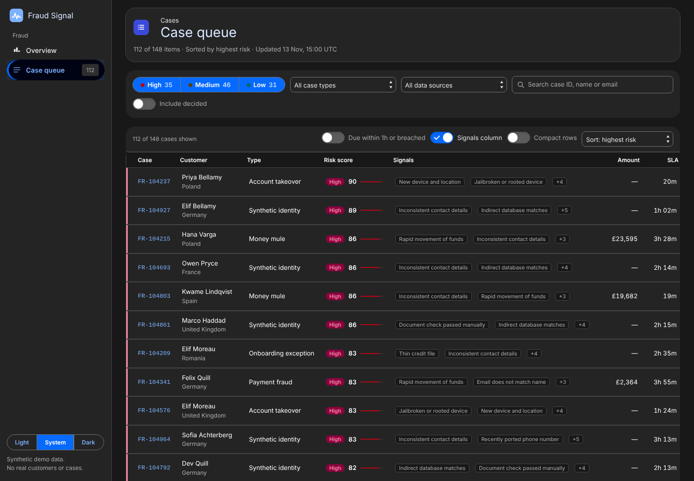 |

---

## Round 11: navigation active state

> **Feedback:** "Why do we have this half circle on the side? Can you align with SLDS 2?"

**Cause:** SLDS 2 marks the active navigation item with a full-width tint and a **straight 4px accent bar** on the left edge. Our own pill-shaped background and rounded corners sat on top of it and bent the bar into a half circle.

**What changed**
- Removed the custom radius, background and colours from the navigation. SLDS 2 now draws the active, hover and section-title styles itself.
- The navigation runs edge to edge in the sidebar, as in SLDS, so the bar sits on the sidebar's edge.

**Principle:** when the design system has a component, don't restyle it; set layout only.

| Before | After |
|---|---|
| 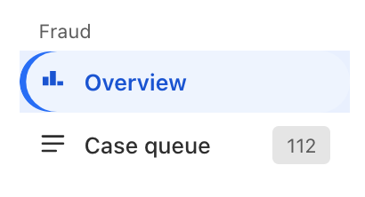 | 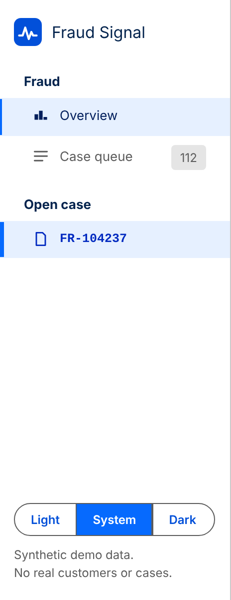 |

---

## Round 12: Top risk factors explained

> **Feedback:** "On the Top risk factors, what do Cases and Points mean?"

**The answer:** *Cases* is how many cases a factor appears in (how common it is). *Points* is the average number of points it adds to a case's 0–100 risk score when it appears (how serious it is). The screen only showed one of these at a time, under one-word labels.

**What changed**
- Every row shows **both numbers**, e.g. "85 cases · +15 pts". The one being sorted by is in bold.
- The switch is now **"Sort by: Most common | Biggest impact"**.
- An **ⓘ** next to the title explains both measures, and that a factor can be common but minor, or rare but serious.
- Factor names sit on their own line above the bar, so they're never cut off.

**Principles:** say what a number measures; show related numbers together; buttons say what they do.

| Sorted by most common | Info popup |
|---|---|
|  | 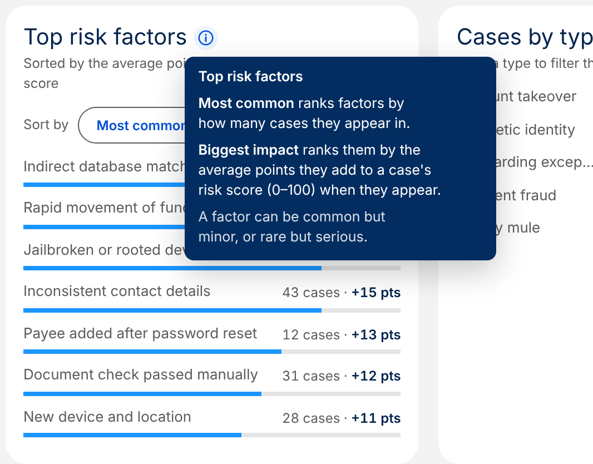 |

---

## Round 13: design system and Storybook

> **Feedback:** "Is it possible to create a design system file in GitHub on typography, colour, card and info icon, whatever is relevant for observability, so developers and designers can work in live code?" … "Also have documentation like the story, a storybook for the design system, which is separate?"

**What we built**
- **Storybook** (`npm run storybook`): Introduction, Foundations (colour, typography, spacing and shape), Components (card, metric card, info icon, badges, button, filters, page header, progress bar, risk score cell, activity timeline), Charts and AI patterns. Each story has **editable controls**, a docs tab, and a **light/dark switch** in the toolbar. Telemetry is turned off.
- **A separate design system site** (`npm run dev:ds`, and its own shareable link): every foundation and component rendered live, **copyable code**, and **do / don't rules**. Colour swatches read their values from the running page, so they're always current in both themes.
- **`DESIGN_SYSTEM.md`**: principles, token tables mapped to SLDS 2 hooks, typography, a component table with rules, writing guidance, and how to add a component.
- **`src/design-system/index.ts`**: one import point for every shared component.
- The GitHub Pages deploy now also publishes Storybook at `/storybook/` and the design system site at `/design-system.html`.
- Fixed while building the chart stories: the alert chart's y-axis could show decimal labels on small data; it now always uses whole numbers.

| Design system site | Storybook |
|---|---|
|  |  |


---

## Round 14: decision buttons follow SLDS 2

> **Feedback:** "In the Decision section, is the colour of the Decline, Refer and Accept buttons based on the SLDS 2 design system?"

**The answer:** only partly. Record decline (destructive) and Record accept (success) were SLDS 2. Record refer was a brand button **recoloured orange**, because SLDS 2 has no warning button. The Decline / Refer / Accept choice used neutral buttons **recoloured** red, orange and green. Both broke our own rule: never restyle an SLDS component.

**What changed**
- The choice is now an SLDS 2 **radio button group**, the control for "pick exactly one". The recommendation sits on a line below it ("Recommended: Decline, based on risk score 90").
- The **Record** button carries the meaning with SLDS 2 variants only: **destructive** for Decline, **brand** for Refer, **success** for Accept.
- DESIGN_SYSTEM.md, the design system site and Storybook now state this rule.

**Principle:** keep the research intent (colour shows the outcome) inside the design system's own variants.

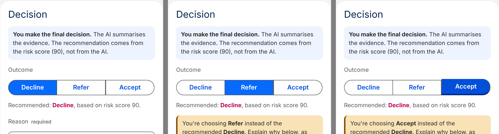

---

## Round 15: button hierarchy and choosing controls

> **Feedback:** "What's the rule on when to use a radio button and a dropdown in this scenario? Also the Record refer and Record accept buttons are different colours." … "I think A if it is the standard design system. Only Cancel is red, right? Also primary vs secondary logic exists too."

**Answers**
- **Radio button group** for exactly one of 2–4 short options people should compare (Outcome). **Dropdown** for 5+ options, long or changing labels, or limited space (Reason, case type, data source).
- **Red (destructive) is only for delete or remove.** Cancel is a **secondary** (neutral) button, not red.
- SLDS has a hierarchy: **primary** (brand, one per area), **secondary** (neutral), **tertiary** (base/link), plus destructive and success for special cases.

**What changed (option A, SLDS-strict)**
- The **Record** button is now one **primary** button for every outcome; only the label changes: "Record decline", "Record refer", "Record accept".
- **Show all evidence** in the Risk Hub was turning primary when active, giving the case view two primary buttons. It's now secondary with the SLDS selected state.
- **DESIGN_SYSTEM.md**, the design system site and Storybook now include a **button hierarchy** table and a **choosing a selection control** table.

**Principles:** one primary action per area; colour carries meaning in badges and text, not in which button you get.

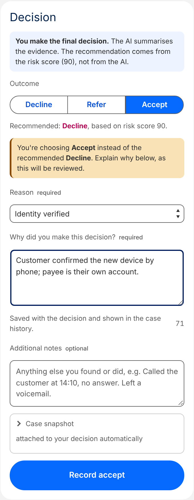

| Button hierarchy | Choosing a control |
|---|---|
| 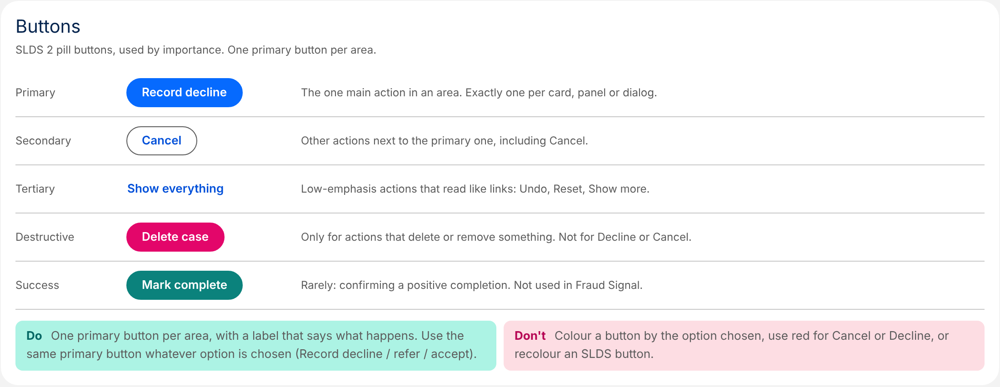 | 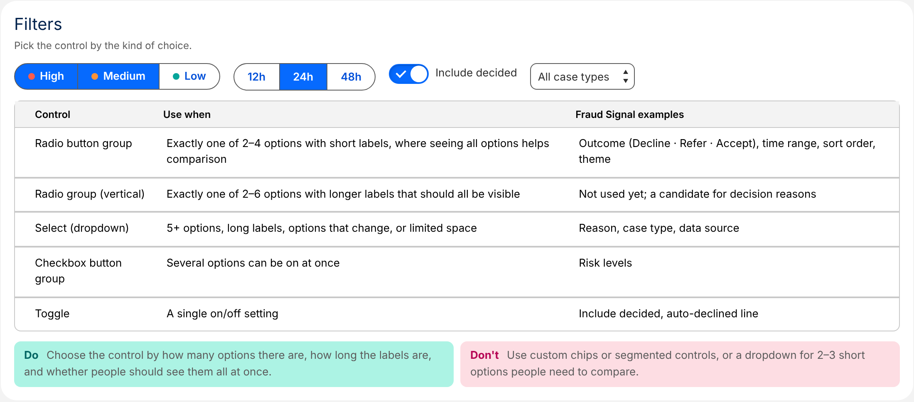 |

---

## Round 16: scoped notifications

> **Feedback:** "Here is the scoped notification. Can you please apply it where necessary, with the icons?" (SLDS 2 Components for Web, Scoped Notifications)

**SLDS 2 rule:** advisory information that isn't important enough for an alert, shown as a status bar inside its container. Not dismissible. Utility icon + message + optional link. Five variants: default, info, warning, error, success.

**Where we applied it**

| Variant | Where | Message (and link) |
|---|---|---|
| Info | Overview · Alert volume | Spike explanation (*Show account takeover only*) |
| Warning | Overview · Data source health | ID document verification degraded (*Show affected cases*) |
| Error | Case queue | N cases have breached their SLA (*Show urgent cases only*) |
| Error / Warning | Case page, top | SLA breached, or due within 1 hour |
| Info | AI fraud summary | Showing one fraud type or source only (*Show everything*) |
| Warning | Source evidence | A source this case relies on was degraded (*View ID check*) |
| Info | Decision | You make the final decision |
| Warning | Decision | Choosing a different outcome from the recommendation |
| Success / Warning | Decision, after recording | Decision recorded; overrode the recommendation |
| Default | Case snapshot, empty states | Where the snapshot comes from; nothing matches the filters |

They replace the custom notes, coloured boxes and annotations used before. The component is in the design system (`ScopedNotification`), on the design system site, in Storybook and in DESIGN_SYSTEM.md.

**Principle:** one standard way to show status inside a container, with an icon and a next step.

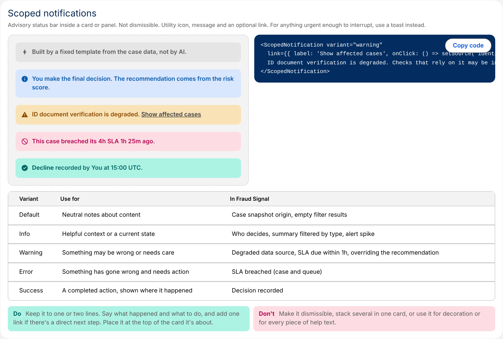
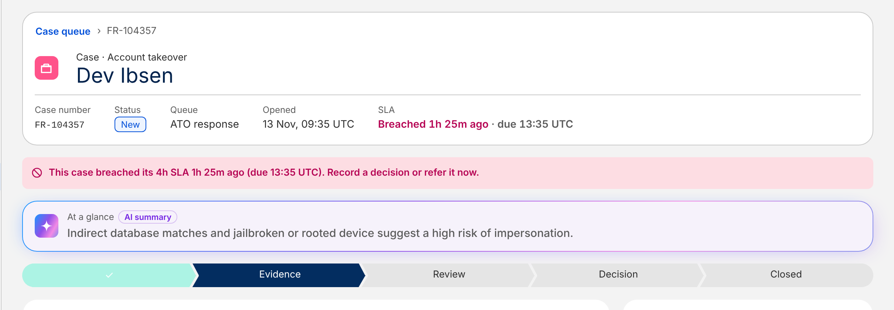

| Decision recorded | Degraded source (dark mode) |
|---|---|
| 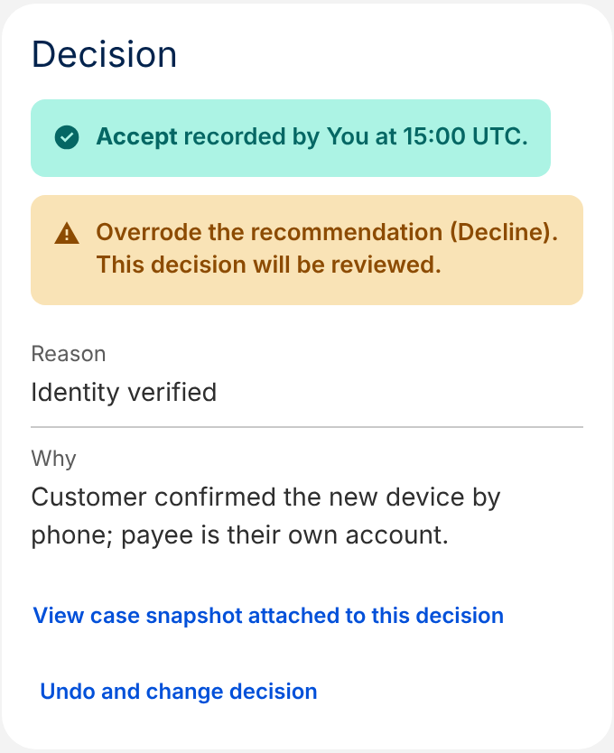 | 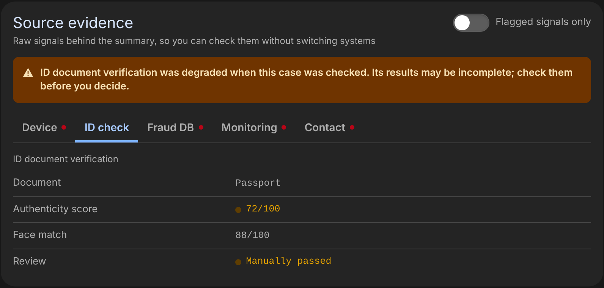 |

---

## Round 17: "Adjust score", not "Edit"

> **Feedback:** "In the Fraud summary we have an Edit button but I cannot edit anything?"

**Cause:** the button worked, but not as its label promised. It let you untick risk factors to take them out of the score; it never edited the summary text. The checkboxes were also plain browser checkboxes.

**What changed**
- Renamed to **Adjust score** ("Done adjusting" while active).
- An **info notification** explains what you can do, and that the AI's text isn't edited (corrections go through 👎).
- **SLDS checkboxes** beside each factor; excluded factors are greyed and struck through, and the gauge shows "Model score 90, adjusted by you (−20)".
- The adjustment is **saved with the decision** ("Score adjusted: 90 → 70. Excluded: Jailbroken or rooted device (−20)") and shown in the activity timeline.
- Design system writing rule: name a button after what it changes.

**Why the AI text stays read-only:** editing what the AI wrote would blur who said what in the audit trail.

| Before ("Edit") | After ("Adjust score") |
|---|---|
| 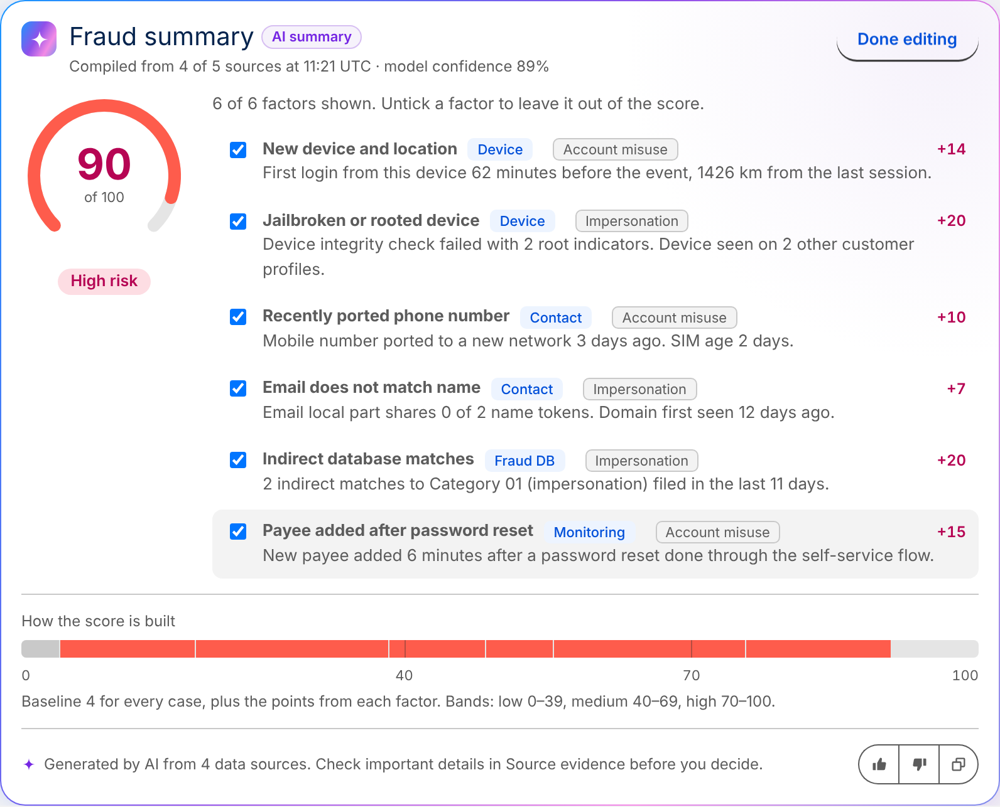 | 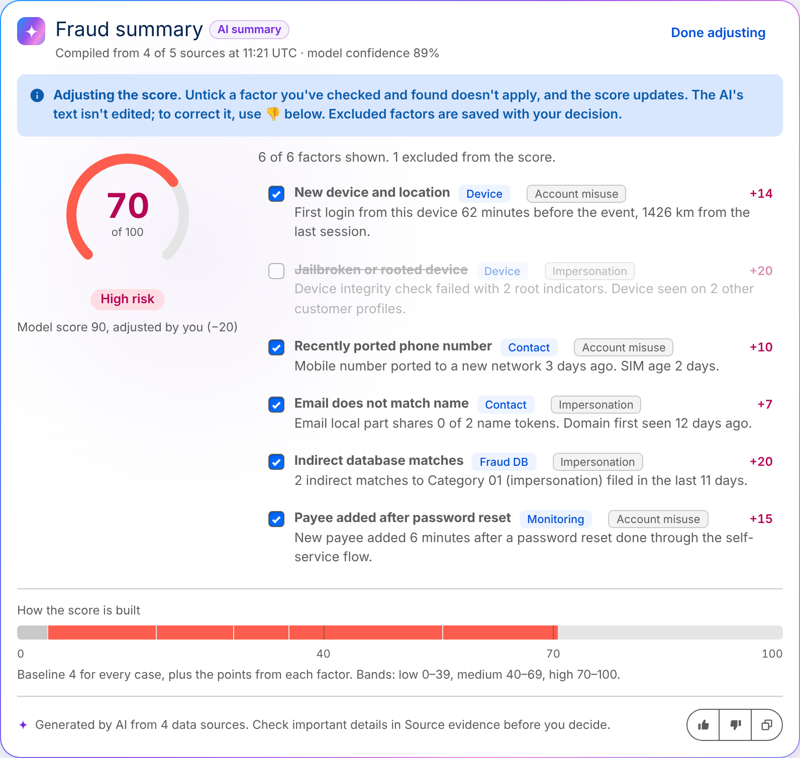 |

---

## Round 18: risk thresholds on screen

> **Feedback:** "With adjusting the score, what is the threshold?" … "Maybe best to show that data somewhere so the user knows that."

**What was missing:** the bands (low 0–39, medium 40–69, high 70–100), their SLAs and recommendations, and the auto-decline line (85) were only partly visible. Adjusting a score could change the band without saying so, and there was no guardrail on large adjustments. Medium cases were also randomly recommended Refer or Decline.

**What changed**
- One source for all thresholds in the code (`THRESHOLDS`), marked as **placeholder values to be confirmed by fraud policy**.
- A **Risk thresholds** table (band, score, SLA, recommendation, auto-decline) under the score in the Fraud summary, with **this case's band highlighted**, and on the Overview's Risk score distribution card. An ⓘ explains it.
- An **auto-decline marker at 85** on the "How the score is built" bar.
- When an adjustment **crosses into another band**: a warning with that band's recommendation, and a line in the Decision panel.
- **Large adjustments** (30+ points or across two bands): an error suggesting a second reviewer (Refer), repeated in the Decision panel if Accept is chosen.
- Medium cases now always recommend **Refer**, matching the table.

**Principle:** if a number drives a decision, show the rule behind it where the decision is made.

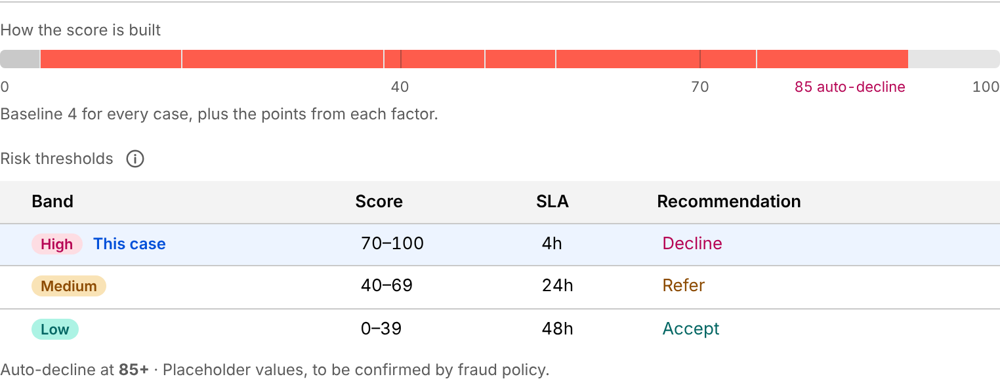

| Adjusted across a threshold | Overview |
|---|---|
| 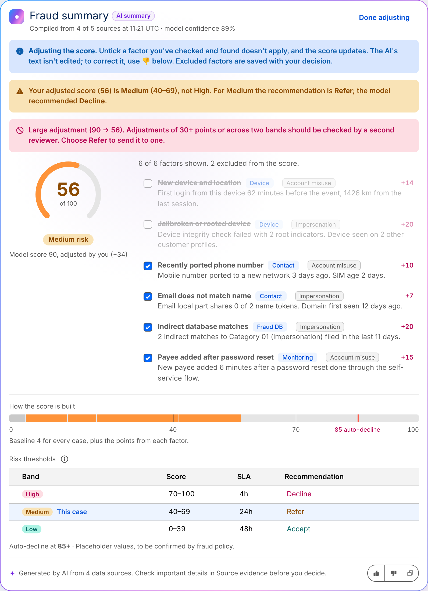 | 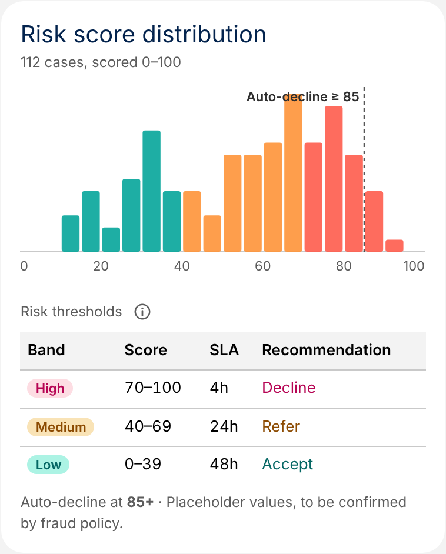 |

---

## Round 19: Version B, integrated evidence

> **Feedback:** "When we designed this, did we cater for this first design too?" (earlier Fraud Data Visualisation research) … "What do you think is best: integrated or separate?" … "Can I have a version B integrated then, so we don't lose the one we have now?"

**Gap found:** the earlier research's core, the customer's **transactional and behavioural history** (7 days vs 3 months, absolute changes, payees, account changes, grouped with info icons and plain terms), wasn't in the dashboard. *Source evidence* was organised by platform, which mirrors the toggling problem the research set out to remove.

**Decision:** integrate, don't separate. A separate page would bring the switching back. Group evidence by the specialist's question and reveal detail progressively.

**Version B (new)**
- One **Evidence** card replaces Source evidence: **Money · Behaviour · Account changes · Identity** (SLDS accordion), each with its question, an unusual count, and source tags on every row.
- **Last 7 days / Last 30 days** against the customer's **usual weekly average over 3 months**. **Absolute numbers and changes only**, following the earlier "eliminate manual calculations" decision.
- **Plain terms** with an ⓘ per measure saying what it can indicate (e.g. money in: mule activity or a safe-account scam). The earlier research found "turnover", "saving de-funding" and percentages confusing.
- **Payees paid in the last 7 days** (new payees flagged), **top spending** (out-of-character merchants flagged), **current device**, **account changes in the last 30 days**.
- The relevant section **opens first** by case type; **Examine in Evidence** on a finding jumps to its section; **Unusual only** toggle; new customers get a note that there's no history.
- The Overview uses **absolute numbers** instead of percentages.

**Version A kept:** unchanged as the default, and saved on the `round-18` branch. A **Layout: A · B** switch in the sidebar compares them. Each has its own link.

| Money (money mule case) | Behaviour (account takeover case) |
|---|---|
| 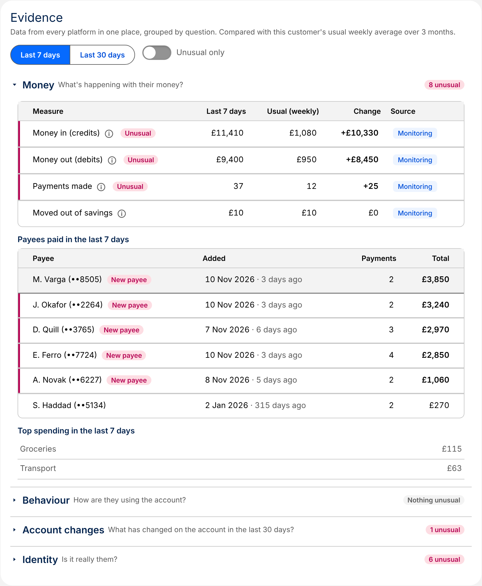 | 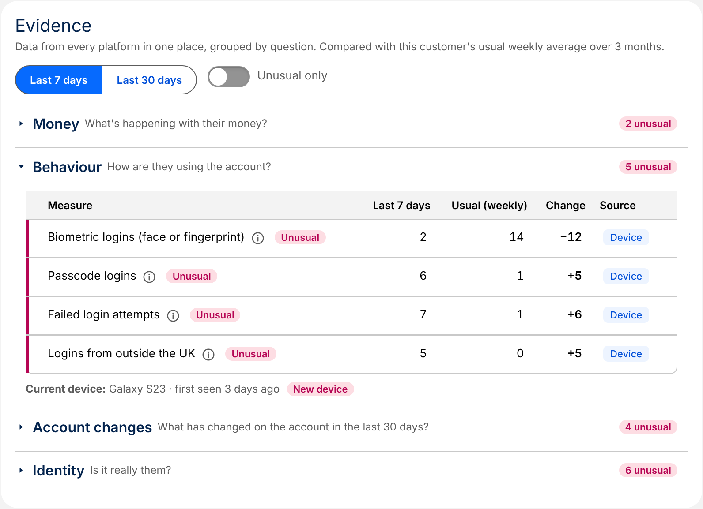 |

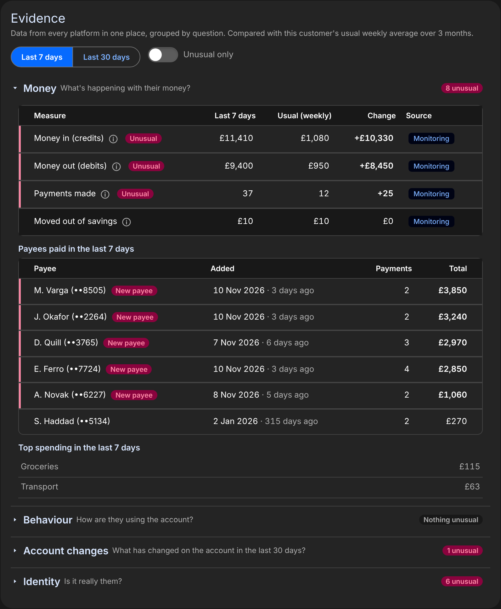

---

## Round 20: one record, the summary follows the data

> **Feedback:** "Those data, part of previous graphs? And summary?" … "Yes please make it real and follow the data." … "The goal is data aggregated from 4–5+ applications in one, so the fraud specialist can decide quickly without toggling across those applications."

**Problem:** in round 19 the Evidence card used its own data, separate from the AI summary and findings. They could contradict each other (e.g. a finding saying "same device for 600 days" while Evidence showed a new device). If the AI and the evidence disagree, the specialist stops trusting both.

**Version B now uses one record per case** (`src/activity.ts`, `caseRecord`):
- The rules engine's **risk factors** decide what happened. The customer's activity is built **once** from them: money, payees, logins, device, account changes and identity checks.
- The **AI summary, factor details and findings are written from those same figures**. For example, "£23,595 came in and £22,420 left within 43 minutes to 4 new payees" matches the Money in row and the four new payees in the table exactly.
- **Every Unusual row is backed by a risk factor, and every finding points to its Evidence row.** Mitigations only appear when the evidence supports them (no "same device" if the device is new).
- **See in Evidence: <row>** on each finding opens the section, scrolls to that row and highlights it.
- **Platforms strip** at the top of Evidence: all 5 platforms with what each contributed ("Account monitoring · 7 unusual", "ID document verification · degraded"). It shows the aggregation, so the specialist knows they don't need to open the other systems.
- Amounts instead of percentages in the summary.
- An automated check over all 148 cases confirms there are no contradictions: 0 problems.

The Overview graphs are unchanged. They count alerts across the team, not one customer, and use the same risk factors. Version A is unchanged.

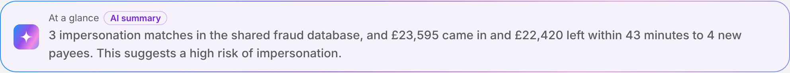

| Findings link to their evidence | See in Evidence jumps to the row |
|---|---|
| 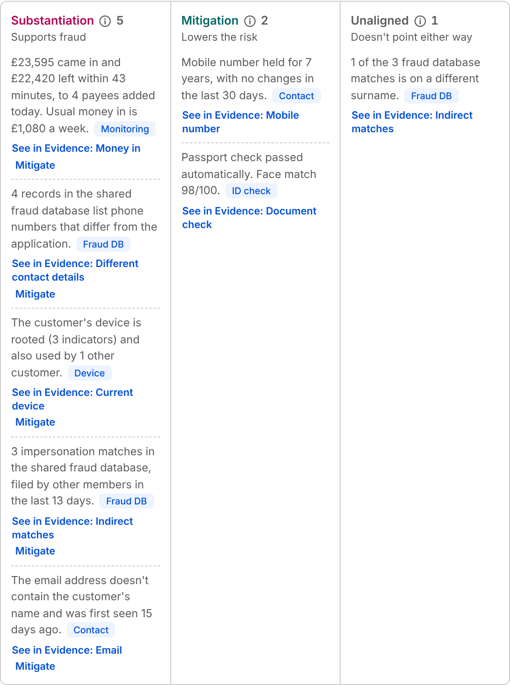 | 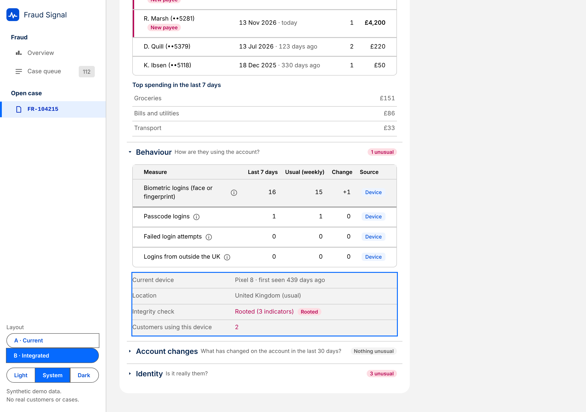 |

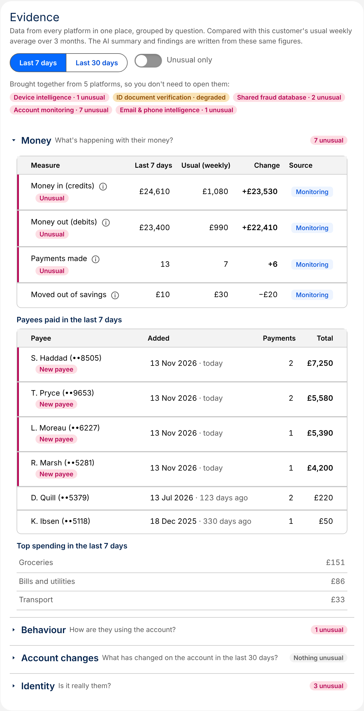

---

## Round 21: Observability for the team lead

> **Feedback:** "Is this a case study of observability?" … "What is the use case of observability in a case manager?" … "Where are the fraud SLA breaches where we need to take action?" … "Can I have a new screen for the team lead, based on observability, so they can assign the task to the fraud specialist?"

**Answer:** the case page is a **decision tool** for the specialist. Observability is about **the work and the systems**: is work flowing, why is it late, are the systems feeding cases healthy, and are decisions good? SLA information existed but was spread across 4 places and said *that* a case was late, not *why* or *what to do*.

**New screen: Team lead › Observability** (`#observability`, in both Version A and B). The sidebar badge shows breached cases.
- **Alerts at the top:** breached and due-within-1-hour counts, how many breached cases have no owner, and which degraded system affects how many cases. Each has a link to those cases.
- **Status tiles:** SLA breached, due within 1 hour, unassigned, team capacity (free slots and who's available), AI recommendation agreed (in numbers, not %).
- **Act now:** open cases sorted by SLA, each with its step, time in step and **why it's at risk** (Unassigned, Specialist unavailable, Specialist overloaded, System degraded, Waiting on customer, In progress), with an ⓘ that says what to do.
  - **Assign / Reassign to [suggested]** on each row: the suggestion is an available specialist with the right skills and the most free capacity.
  - **Bulk assign:** select cases, then **Assign** to a chosen specialist (primary button) or **Assign to suggested** (secondary).
  - Filter by Breached, Due < 4h, Unassigned or All, and by cause or specialist.
- **Team workload:** each specialist's open cases against capacity (bar turns red when overloaded), breached, due < 1h, average time to decide, decided today. Updates as you assign; select a name to see their cases.
- **Why cases are late** (by cause), **Where cases wait** (time in each step; the slowest is highlighted), **Systems feeding cases** (health of the 5 platforms).
- **AI recommendation: agreed or overridden** by outcome, to spot when the model needs review.
- **Your assignments:** a log saved for audit. The case page header now shows **Assigned to**.

Fictional team and synthetic data, seeded separately so the existing cases don't change.

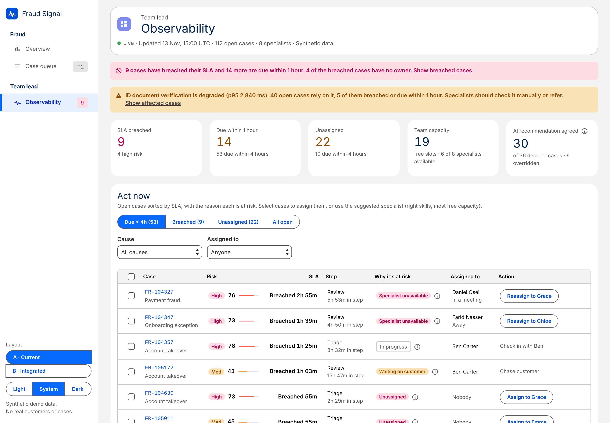

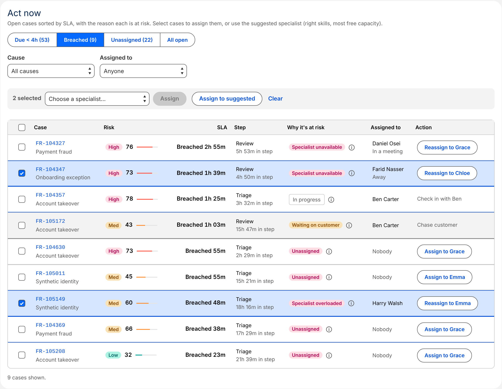

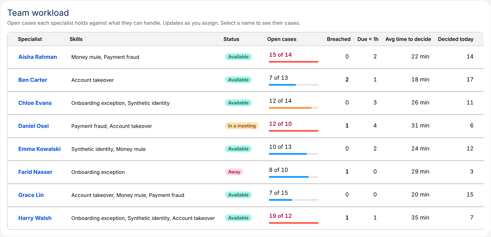

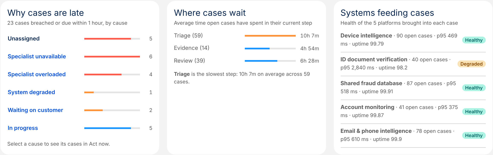

---

### Earlier branch names

Before this log, three versions were saved as `version-1`, `version-2` and `version-3`. They are the same code as `round-3`, `round-4` and `round-5`.
